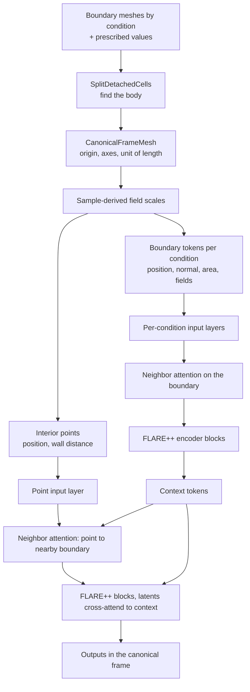

# GeoTransolver++ (working name): design and status

Branch `experimental-equivariant-anchor-model` on the `coreyjadams` fork.
Companion: `geotransolver_invariance_scoping.md` (diagnosis of GeoTransolver).

## 1. Goal

A GeoTransolver-lineage model for boundary-value problems that is:

- invariant to rotation and translation of the whole problem;
- invariant to how the boundary and the interior are sampled, up to
  quadrature error (every pooling step is a measure-weighted average);
- invariant to the order of points and boundary samples;
- driven by boundary conditions as first-class inputs, one set of tokens per
  condition, each with its own fields.

ISLA (`physicsnemo.experimental.models.isla`) reaches the same symmetries a
different way: it has no frame, and the network only ever sees dot products
and distances. GeoTransolver++ instead computes one frame from the geometry
and runs an ordinary network in it. The point of the exercise is to compare
the two.

| | ISLA | GeoTransolver++ |
| --- | --- | --- |
| Rotation and translation | No frame; invariant features only | One canonical frame from the body |
| Inputs | Dot products of declared vectors | Plain coordinates and components |
| Vector outputs | Rebuilt from input vectors | Three free components per vector |
| Known cost | Custom layers and heads | The frame jumps near symmetric shapes |

## 2. Data flow

## 3. The canonical frame

`canonical_frame` in `physicsnemo/datapipes/transforms/mesh/transforms.py`,
applied by `CanonicalFrameMesh`. Computed once per sample in the datapipe,
in float64, from every cell of the full mesh.

1. Origin: the area-weighted centroid of the body.
2. Unit of length: the body's RMS radius (`rescale=True`).
3. Axes: principal axes of the body's area-weighted covariance, largest
   variance first.
4. What the covariance leaves open is settled by a fixed list of vectors
   that rotate with the problem: the body's third moment, then the mean
   inlet velocity, then the offset of all boundaries' centroid from the
   body's. Equal variances take the first vector with a usable component in
   their plane; each other axis is pointed along the first vector with a
   usable component on it.
5. The weakest axis is pointed by the right-hand rule. Reflections are not
   factored out.
6. An axis nothing fixes is reported (`source == -2`) and left arbitrary.

The body is the wall cells not connected to any other boundary
(`SplitDetachedCells`). A sample with no body uses all boundaries.

Known limits:

- The frame is deterministic, not continuous. Two nearly identical shapes
  on either side of a threshold get different frames.
- On a subsample the axes can flip, so the frame must come from the full
  mesh. On 16 AeroZoo samples, rebuilt from 5% of the cells, an axis flipped
  on 9 of 15 bodies.
- The "usable component" threshold is 1e-3. Lower lets float32 noise on a
  symmetric body set an axis; higher leaves more axes arbitrary.
- Untested: a body touching the ground or a wall (it would not be found),
  and two bodies (both become "the body").

## 4. The model

`physicsnemo/experimental/models/geotransolver_pp/`. It expects inputs
already in the canonical frame and is an ordinary network.

- **Boundary encoder.** One input MLP per named condition (position,
  normal, that condition's fields). Any subset of the declared conditions
  may be present.
- **Neighbor attention.** DeFormer's `KNNAttentionBlock` update (edge bias on
  the scores, attention-weighted edge aggregate, one MLP on state, message,
  edge aggregate and log-sum-exp), as cross-attention from points to
  boundary tokens and as self-attention on the boundary. Neighbors are the
  nearest `n_neighbors` within `radius`. The scores carry the log of each
  token's area and of a window that falls to zero at the radius, and the
  softmax has one extra empty slot, so the message is a quadrature over the
  boundary in range and fades in as boundary enters the range.
- **Blocks.** Measure-weighted FLARE++ blocks. The latents cross-attend to
  the boundary context. The global condition sets the layer norms' scale
  and shift.
- **Outputs.** `out_dim` channels; a vector is three of them, in the
  canonical frame.

Known limits:

- A point farther than `radius` from every boundary sees the boundary only
  through the latent tokens (and the wall-distance input).
- Above `n_neighbors` tokens in range the nearest stand for the rest, which
  depends on the token density.
- The neighbor attention gathers keys and values per neighbor: memory grows
  as points x neighbors x hidden. DeFormer's fused kernel is self-attention
  only and was not reused.
- Single point stream; no Transformer Engine, no token-sharded inputs.

## 5. Measured so far

All with small untrained models; symmetry and sampling error only.

| Check | Result |
| --- | --- |
| Synthetic bodies: rotation, shift, rescale, shuffling, splitting samples | 1e-15 (float64) |
| AeroZoo, 3 samples: rotation + shift + rescale, float32 | 2e-6 to 9e-6 |
| Same, untrained ISLA for reference | 4e-6 to 1.5e-3 |
| Neighbor attention, tokens shuffled | 0 |
| GeoTransolver's ball query + MLP, points shuffled | 6% |
| AeroZoo, 8,192 boundary tokens vs 32,768 (RMS difference) | 6% to 12% |

The notebooks in `examples/minimal/equivariance/` reproduce these per
component: the frame, the boundary conditions, the attention blocks and the
full model.

## 6. Training on AeroZoo

Wired into the unified external aerodynamics recipe
(`examples/cfd/external_aerodynamics/unified_external_aero_recipe`, README
section "AeroZoo"): one dataset config, `aerozoo_volume`, and three model
configs that share its pipeline.

| Config | Model | Boundary conditions |
| --- | --- | --- |
| `geotransolver_volume_aerozoo` | GeoTransolver | One global token |
| `geotransolver_bc_volume_aerozoo` | GeoTransolver | On the geometry tokens |
| `geotransolver_pp_volume_aerozoo` | GeoTransolver++ | One token set per condition |

`+dataset_overrides.canonical_axes=false` turns the rotation off for any of
them, which separates what the frame gives from what the model gives.

Only benchmark-legal inputs are used. The length is the body's RMS radius
and the speed is the area-weighted RMS inlet speed, both from the sample.

Not done:

- Inference in SI units and the benchmark's metrics.
- Targets beyond velocity and pressure; turbulence inlet values as inputs.
- The boundary task.
- Runs at scale: only two-epoch smoke runs and a short overfit on 11
  samples, on CPU.

## 7. Open questions

1. Is the frame's discontinuity visible in trained error? Compare a split's
   test error on samples near a tie against the rest.
2. Does the canonical rotation help GeoTransolver itself? Run the
   `canonical_axes=false` ablation.
3. Should the tie-break convention be offered for
   `physicsnemo.mesh.spatial.canonical_frame`, which ISLA uses for ordering
   and which falls back to the lab axes on a tie?
4. Name: `GeoTransolverPP` is a working name.
