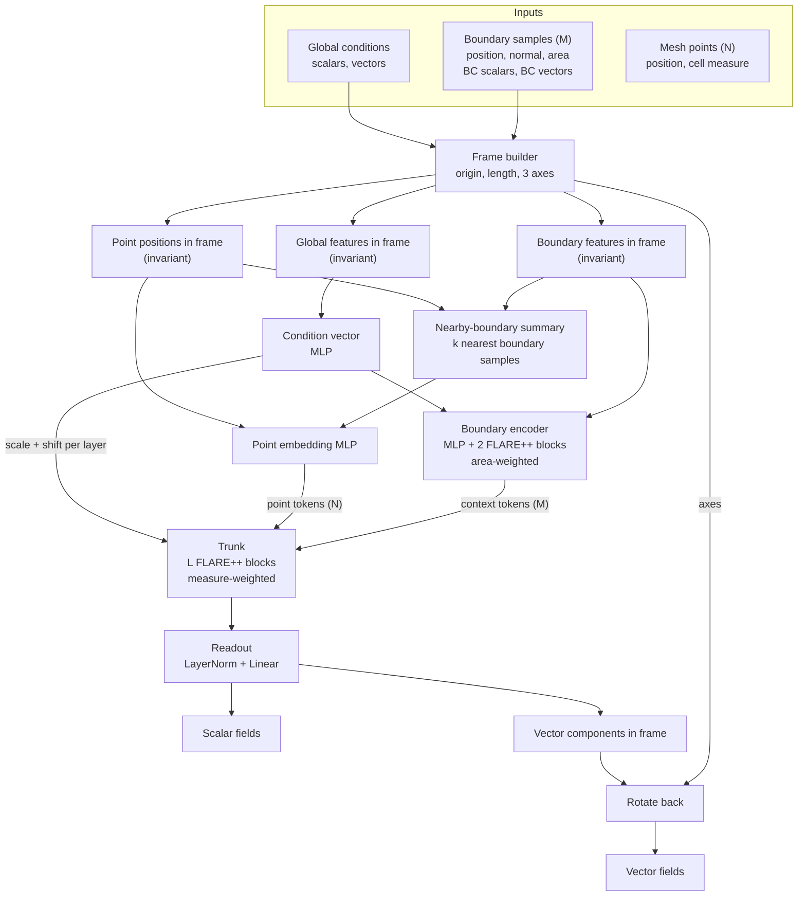
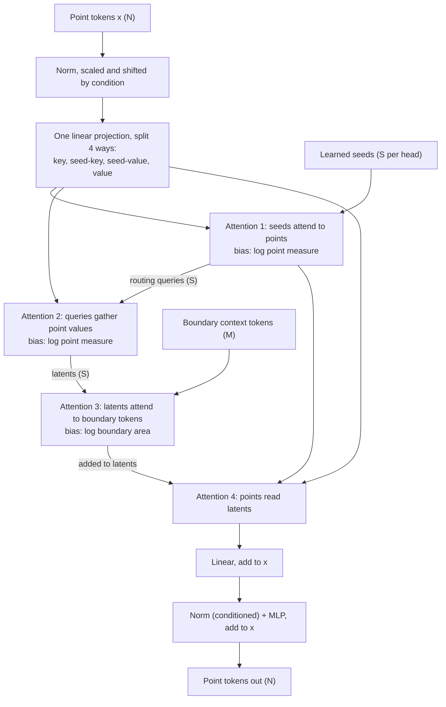

# GeoTransolverPP (working name): architecture design and plan

Status: a prototype exists on the local branch `experimental-equivariant-anchor-model`
(`physicsnemo/experimental/models/geotransolver_pp/`, uncommitted). It was
written **before** this document, which is the wrong order. Treat the prototype
as a spike that shows the symmetry mechanics work, not as a reviewed design.
This document describes what the prototype does, marks every choice that was
never reviewed, and proposes a staged plan with review gates.

Companion: `geotransolver_invariance_scoping.md` (diagnosis of GeoTransolver).

## 1. Requirements

Decided by you:

| # | Requirement |
| --- | --- |
| R1 | Rotation and translation equivariance, exact, built in. |
| R2 | Parity (reflection) is not assumed. |
| R3 | Boundary conditions are a required model input, encoded together with geometry. |
| R4 | Invariance to meshing and discretization where possible, tolerance otherwise. |
| R5 | FLARE++ routing, not PhysicsAttention. |
| R6 | Remove information bottlenecks (the alpha mixing parameter and similar). |
| R7 | GeoTransolver lineage. No AB-UPT anchor/query split. |
| R8 | New model in `experimental`, own name (to be chosen by you). |

## 2. Data flow

Everything between the frame builder and "rotate back" sees only quantities
that do not change under rotation or translation. That region is ordinary,
unconstrained network code.

## 3. One trunk block

- Attention 1, 2 and 4 are FLARE++ as in `physicsnemo/nn/module/flare_attention.py`,
  plus the measure bias.
- Attention 3 is GALE's idea (context meets the latents, not the points), with a
  plain residual add where GALE has the alpha mix.
- Boundary-encoder blocks are the same block without attention 3.
- Cost per block: O(N·S) for points, O(S·M) for context. Nothing is O(N·M) or O(N²).

## 4. Frame builder

Inputs: boundary positions `x_i`, normals `n_i`, areas `a_i`, global vectors `g_k`.

1. Weights `w_i = a_i / sum(a)`.
2. Origin `o = sum(w_i x_i)`. Translation is removed here.
3. Reference length `L = sqrt(sum(w_i |x_i - o|^2))`. All positions are divided by `L`.
4. Candidate vectors: the global vectors, in the order given. If there are fewer
   than two, the rest are learned:
   `v = sum_i w_i [ alpha_i (x_i - o)/L + beta_i n_i ]`, where `alpha_i`, `beta_i`
   come from an MLP on rotation-invariant per-sample inputs (`|x_i - o|/L`,
   `n_i · r_i`, dot products with the global directions, BC scalars).
5. Gram-Schmidt on the first two candidates gives `e1`, `e2`; `e3 = e1 × e2`.

Why this is equivariant: under `x -> R x + t`, `o -> R o + t`, the candidates
rotate by `R`, and the cross product of two rotated vectors is the rotated cross
product for proper rotations. Components of any vector along the axes are
therefore unchanged. Under a reflection `e3` flips relative to the problem, so
the model sees a mirrored input: parity is not enforced (R2).

## 5. Where each requirement is met

| Stage | Rotation / translation (R1) | Discretization (R4) |
|---|---|---|
| Frame builder | Exact (section 4). | Area-weighted sums: converge under boundary refinement. |
| Boundary encoder | Invariant inputs only. | Area-weighted gathers: quadrature error only. |
| Nearby-boundary summary | Distances and frame components only. | **Weak point.** k nearest samples depends on boundary sampling density. Unmeasured. |
| Trunk gathers (attention 1, 2) | Invariant inputs only. | Measure-weighted: exact under point duplication with split measure; quadrature error under resampling. |
| Context attention (3) | Invariant inputs only. | Area-weighted. |
| Scatter (attention 4), MLPs | Pointwise. | Pointwise. |
| Readout | Scalars invariant; vectors rotated back by the frame. | Pointwise. |

Tested so far (double precision, random inputs of ~40 points, untrained
weights): rotation + translation with 0, 1 and 2 global vectors; uniform
rescaling; point duplication with split measure and reordering. Not tested:
boundary resampling, real meshes, float32, trained weights, any accuracy.

## 6. Choices I made that you have not reviewed

| Choice | Where it comes from | Alternative |
|---|---|---|
| Global conditions as per-layer norm scale and shift | adaLN, from diffusion transformers | Global tokens appended to the context set |
| Latents attend to all M boundary tokens directly | GALE (context at latent level) | Pool the boundary to its own latents first; cheaper for large M |
| Boundary encoder depth 2, shares the block design | Mine | Deeper, or a different encoder (#2605 shared geometry encoder) |
| Nearby-boundary summary: k=8 neighbors, weight = area × Gaussian in (d − d_nearest)/d_nearest | Mine, untested | Radius-based area-weighted integral; SDF passed in by the data pipeline |
| Learned frame vectors as invariant-weighted sums | Similar to learned canonicalization methods; not taken from a specific paper | Principal axes with sign averaging; require ≥ 2 global vectors |
| Frame from the *first two* global vectors only | Mine | Use all vectors; choose the best-conditioned pair |
| Reference length = RMS boundary radius, no override | Mine | Caller passes a reference length (GLOBE does this) |
| Raw frame coordinates into the embedding MLPs | Mine (simplest) | Fourier features |
| Single point stream; surface and volume are not separate | Mine (simplest) | Two streams sharing latents |
| Point measure defaults to uniform; boundary area and cell volume are each normalized to sum to 1 | Mine | A learned relative weight between sets |
| Attention scale 1/sqrt(dim_head); 4-way fused projection; seeds | FLARE++ as implemented in this repo | — |
| Vector outputs as components on the global frame | Canonical-frame approach (scoping doc option A) | Local basis per point (GLOBE style, option B) |

## 7. Risks

1. **Frame degeneracy.** Parallel defining vectors, or a learned vector near
   zero for a symmetric boundary, make the frame undefined and its gradient
   large nearby. Nothing guards this today.
2. **The origin and length follow the boundary passed in.** A ground plane or
   far-field patch dominates both. Two datasets with different domain extents
   around the same body would be normalized differently.
3. **Measure weighting may starve the boundary layer.** Near-wall cells are
   tiny, so a volume-weighted gather nearly ignores them unless the attention
   scores compensate. This could cost accuracy exactly where it matters.
4. **The nearby-boundary summary is the least principled part** and is the
   main way a point learns where the wall is.
5. **No accuracy evidence.** Exact symmetry can cost accuracy if any
   symmetry-breaking input is missing from the boundary description.
6. **Not supported:** Transformer Engine, token-sharded inputs, structured grids.

## 8. Plan

Each stage ends with something you review before the next starts. Nothing is
committed or pushed without asking.

| Stage | Deliverable | Gate |
|---|---|---|
| 0 | This document. | You accept, change, or reject sections 2–6. |
| 1 | Invariance test suite (translation, rotation, local refinement, changing N, point order) that runs against any model through a thin adapter. Baseline numbers for current GeoTransolver. | Numbers reviewed; they define "better". |
| 2 | Measure-weighted FLARE++ block as its own reviewed unit, with tests. | Block design agreed (section 3). |
| 3 | Frame builder as its own unit: degeneracy handling, float32 behaviour, tests on real geometry. | Frame choice agreed (section 4). |
| 4 | Boundary encoder + data adapter for one dataset: keep named patches, attach BC type and values, cell measures. | Dataset and BC encoding agreed. |
| 5 | Assemble the model; rerun stage 1 suite including boundary resampling. | Suite results reviewed. |
| 6 | Small training run against GeoTransolver on the same data and budget. | Go / no-go on the architecture. |

The prototype maps onto stages 2, 3 and 5. I would keep it only as reference
and rebuild each piece at its stage, unless you prefer to review it in place.

## 9. Open questions for you

1. Section 6: which choices do you reject outright?
2. Stage 4: which dataset first, and does it carry named boundary patches?
3. Vector readout: global frame (current) or a local per-point basis?
4. Should surface and volume be separate streams as in GeoTransolver?
5. Name.
